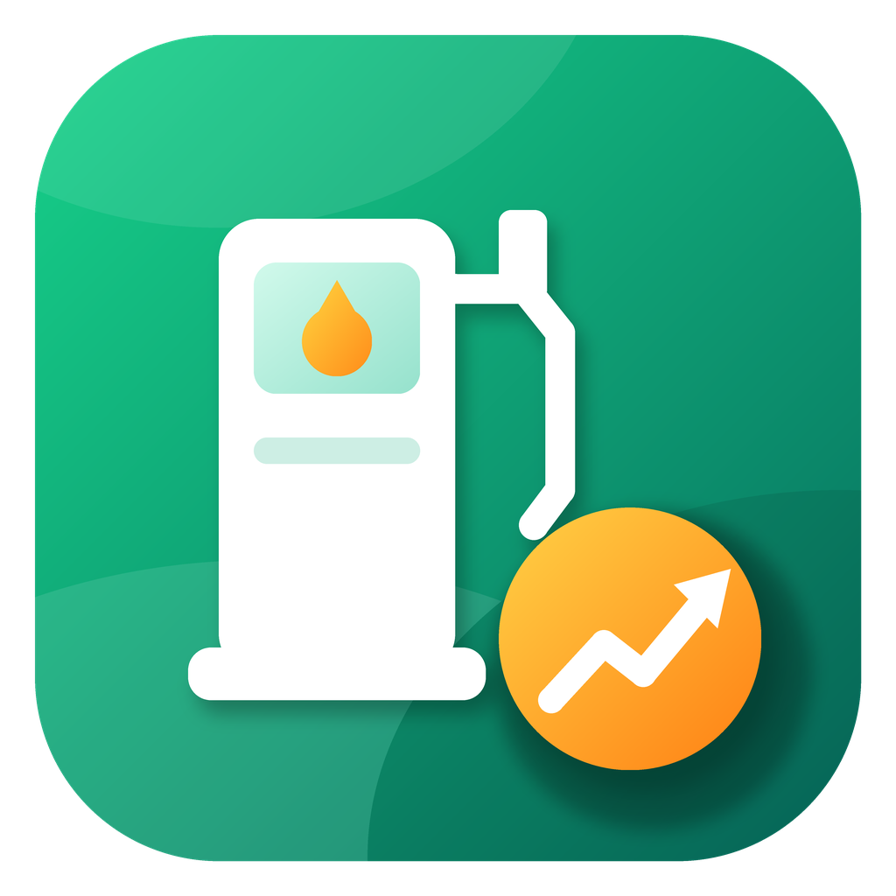
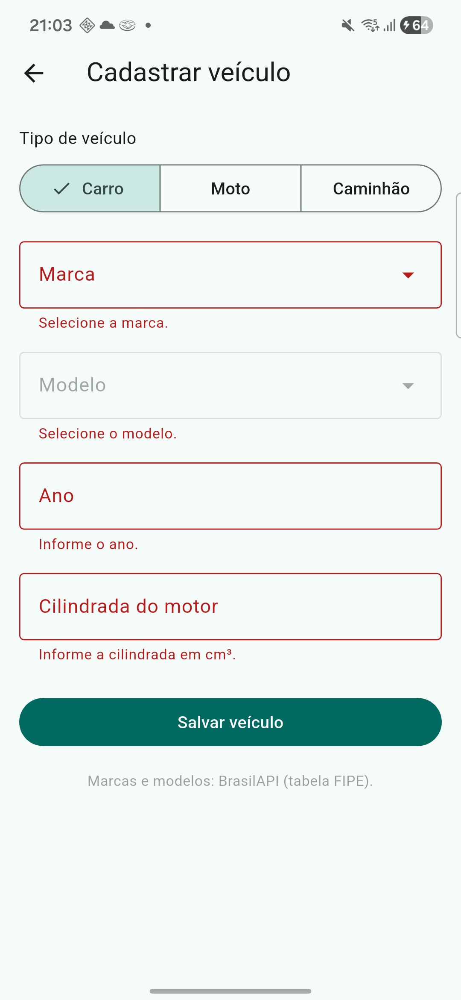
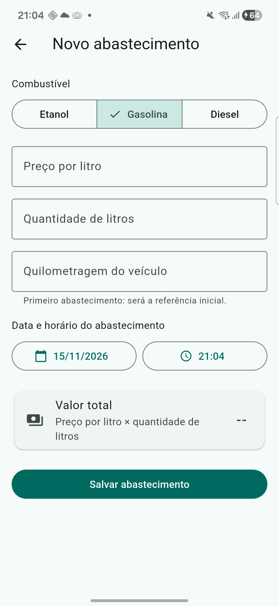
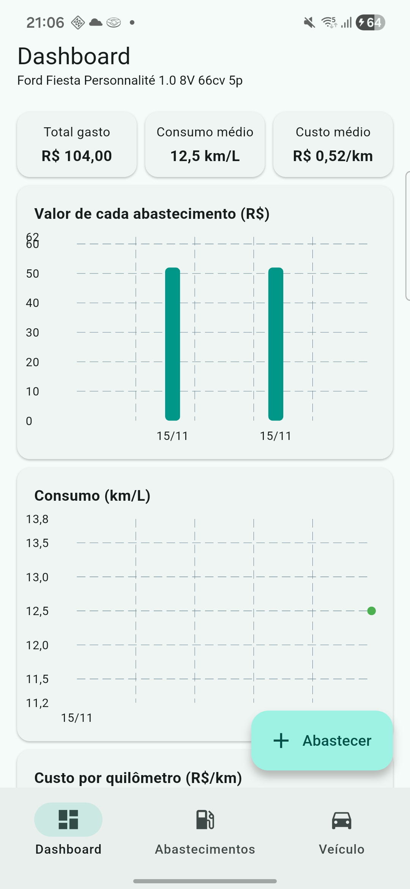
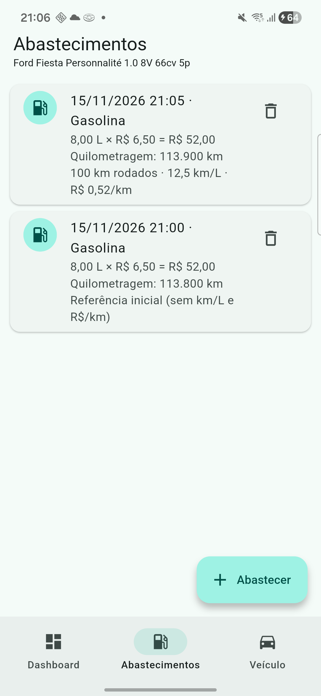

# Controle de Combustível



Aplicativo Flutter (Android) para registrar os abastecimentos de um veículo e acompanhar os gastos com combustível e o consumo ao longo do tempo.

Atividade Substitutiva da Prova 1 · Programação para Dispositivos Móveis II · Prof. Arley · FATEC Jacareí

**Autor:** Carlos Eduardo da Silva Magalhães

## Descrição

- **Cadastro do veículo** (um por vez): tipo, marca, modelo, ano e cilindrada. Marcas e modelos vêm da BrasilAPI, e os modelos listados são os da marca escolhida.
- **Exclusão do veículo** com confirmação. Os abastecimentos dele também são excluídos.
- **Registro de abastecimentos:** combustível (etanol, gasolina ou diesel), preço por litro, quilometragem, litros, data e horário. O valor total (preço × litros) é calculado automaticamente.
- **Dashboard** com o valor de cada abastecimento, o consumo (km/L) e o custo por quilômetro (R$/km), em gráficos.
- **Persistência local:** os dados continuam salvos depois de fechar e abrir o app.

### Como os indicadores são calculados

Todos os abastecimentos completam o tanque. O primeiro é a referência inicial e não tem km/L nem R$/km. A partir do segundo:

| Indicador | Cálculo |
|---|---|
| Distância percorrida | km atual − km do abastecimento anterior |
| Consumo (km/L) | distância ÷ litros do abastecimento atual |
| Custo (R$/km) | valor total do abastecimento atual ÷ distância |

Para manter os cálculos corretos, cada novo abastecimento precisa ter quilometragem maior e data posterior à do anterior.

## Como executar

Pré-requisitos: Flutter instalado e um celular ou emulador Android com internet (para a lista de marcas e modelos).

```bash
flutter pub get
flutter run
```

## API e bibliotecas

**API:** [BrasilAPI](https://brasilapi.com.br/docs#tag/FIPE), dados da tabela FIPE.

| Endereço | Uso |
|---|---|
| `GET /api/fipe/marcas/v1/{tipo}` | Marcas de carros, motos ou caminhões |
| `GET /api/fipe/veiculos/v1/{tipo}/{codigoMarca}` | Modelos da marca escolhida |

**Bibliotecas:**

| Pacote | Uso |
|---|---|
| [http](https://pub.dev/packages/http) | Requisições à BrasilAPI |
| [sqflite](https://pub.dev/packages/sqflite) e [path](https://pub.dev/packages/path) | Banco SQLite local (`combustivel.db`, tabelas `veiculo` e `abastecimentos`) |
| [fl_chart](https://pub.dev/packages/fl_chart) | Gráficos do dashboard |

## Capturas de tela

| Cadastro do veículo | Novo abastecimento |
|---|---|
|  |  |

| Dashboard | Abastecimentos |
|---|---|
|  |  |

## Estrutura

```
lib/
├── main.dart
├── app.dart
└── features/combustivel/
    ├── models/          # Veiculo, Abastecimento, Indicador, OpcaoFipe
    ├── services/        # BrasilAPI e erros de consulta
    ├── data/            # Banco SQLite e repositórios
    └── presentation/    # Telas, abas, gráficos e formatação
```
